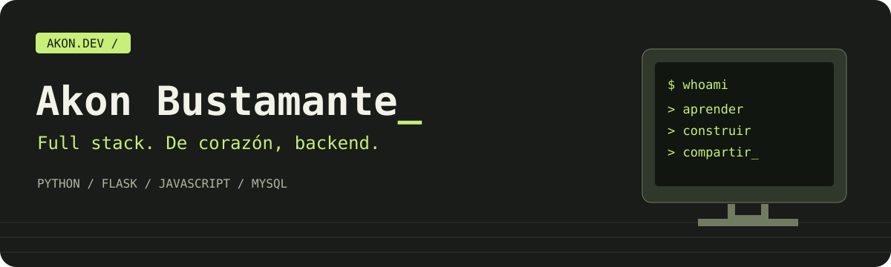

<p align="center"></p>

<p align="center">
  <strong>Un portafolio para explorar, experimentar y conocer mi código.</strong><br>
  Estética retro · Escritorio interactivo · Desarrollo full stack
</p>

<p align="center">
  <a href="https://github.com/akon1212233">GitHub</a> ·
  <a href="https://www.linkedin.com/in/akon-bustamante-b58313319/">LinkedIn</a> ·
  <a href="mailto:akonbustamante11@gmail.com">Contacto</a>
</p>

---

## Una pequeña computadora. Muchas ideas.

Mi portafolio reúne proyectos y aprendizajes de Skillnest en una interfaz inspirada en las computadoras retro. Soy **Akon Bustamante**, desarrollador en formación con especial afinidad por el backend, Python y Flask.

| Explora | Qué encontrarás |
| --- | --- |
| **Akon OS** | Terminal, archivos, notas, calculadora, pixel art y juego de memoria. |
| **Archivo de proyectos** | Búsqueda, filtros por tecnología y categorías, detalles y enlaces al código. |
| **Laboratorio** | Simulación de una API de tareas con peticiones y respuestas HTTP. |
| **Herramientas** | Temporizador, sonidos sintetizados y buscador con `Ctrl+K` / `⌘+K`. |
| **Experiencia** | Tema claro/oscuro, menú móvil y navegación con teclado. |

## Tecnologías

**Python · Flask · HTML · CSS · JavaScript**

Flask sirve la versión local. La exportación es estática y puede alojarse en GitHub Pages, sin base de datos ni claves privadas. El laboratorio simula una API en el navegador; el contacto prepara un correo en tu aplicación de email.

## Ejecutar en local

```bash
python -m venv .venv
source .venv/bin/activate
# Windows PowerShell: .venv\Scripts\Activate.ps1
pip install -r requirements.txt
python server.py
```

Abre **http://127.0.0.1:5000**. El modo debug se utiliza solo durante el desarrollo.

## Versión estática

```bash
python export.py
python -m http.server 8000 --directory dist
```

Abre **http://localhost:8000**. Usa un servidor HTTP: el catálogo de proyectos se carga mediante `fetch`.

## Mapa del proyecto

```text
flask_app/
├── __init__.py          # Aplicación Flask
├── templates/index.html
└── static/
    ├── css/            # Identidad visual y diseño adaptable
    ├── js/             # Interacciones, Akon OS y laboratorio
    ├── media/          # Recursos gráficos
    └── projects.json   # Catálogo de proyectos
tests/                 # Pruebas de lógica JavaScript
docs/                  # Portada y consigna original
export.py              # Genera dist/ para alojamiento estático
server.py              # Servidor de desarrollo
```

## Comprobar la lógica

Con Node.js instalado, sin dependencias adicionales:

```bash
node --test tests/*.test.cjs
```

Las pruebas usan un DOM simulado; no sustituyen la revisión visual en un navegador.

## Hazlo crecer

Edita `flask_app/static/projects.json` para incorporar proyectos. La [guía de uso](GUIA.md) explica la personalización y las herramientas. La [consigna original](docs/CONSIGNA.md) se conserva como referencia académica.

Las notas, dibujos y descubrimientos se guardan en el navegador. No se sincronizan entre dispositivos. El portafolio no incluye video por decisión del autor.

---

<p align="center"><strong>Construir. Entender. Volver a intentar.</strong><br>Hecho por Akon Bustamante durante su formación en Skillnest.</p>
